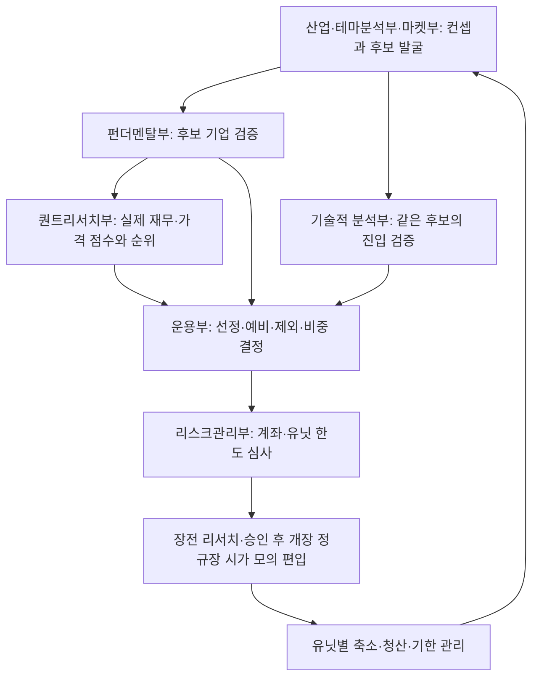

# 트렌드 유닛 투자 방식의 분석과 적용

사용자가 제공한 두 제안서에서 투자 방식과 의사결정 프로세스만 추출했다. 개별 추천 종목, 당시 시장 전망, 과거 운용 수익률은 현재 시스템의 선정 기준이나 투자 신호로 사용하지 않는다. 목표와 손실 한도는 과거 성과가 아니라 편입 전 설정하는 위험 관리 조건이다.

## 핵심 구조

일반형 WRAP 자료는 여러 아이디어 유닛을 병렬로 운용하고 종료된 유닛을 새 아이디어로 교체하는 반복 운용을 강조한다. 주식혼합 제안서는 같은 구조를 참조지수 선정, 계량 점수화, 정성 검토, 위험 관리로 더 구체화한다. 적용할 대상은 특정 상품의 판매 조건이 아니라 이 공통 운용 구조다.

투자 아이디어는 하나의 종목 추천과 다르다. 어떤 환경 변화가 어떤 산업·스타일에 영향을 주는지, 무엇을 관찰해야 하는지, 어떤 사실이 확인되면 논리를 철회할지 먼저 정한다. 그 논리를 구현하는 참조지수와 구성종목 근거를 확인하고, 계량 결과와 기업의 실제 사업·공시를 함께 검토해 바스켓을 구성한다. 편입은 운용부와 리스크관리부의 최종 심사를 거친다.

현재 적용: 파이프라인 5, 2026-10-06. 기존 유닛의 목표·손실·기한 관리는 유지하고, 원본 컨셉과 최종 바스켓을 분리한다. 기업·기술 부서는 발굴 후보를 각각 검증하고 퀀트리서치부가 실제 숫자로 후보 순위·위험값을 계산하며 운용부가 종합 판단한다. 현재 부서 권한과 구현 점검은 [2026-10-06 부서 역할 문서](trend-unit-departments.md)를 따른다.

입력·출처·단계별 누락은 `/api/context`와 `/api/research-check`를 따른다. 기업 검토는 해당 아이디어와 연결해야 하며 다른 아이디어의 통과를 재사용할 수 없다. 신규 원본 컨셉이 없는 과거 바스켓은 재검토 대기로 표시한다. 편입 없이 관찰하는 판단도 근거를 남긴다.

## 제안서의 방식과 시스템의 대응

| 방식 | 자료 위치 | 적용 |
|---|---|---|
| 1~3개월 아이디어를 유닛으로 묶어 병렬 운용 | WRAP 18~20·27, 주식혼합 3·5~8 | `trendUnits` 제안과 실제 체결된 유닛 이력을 분리한다. 목표·손실 한도·달력상 기한은 첫 체결 시 고정한다. |
| Top-down과 Bottom-up의 상호 보완 | 주식혼합 20~21 | 산업·마켓이 컨셉 후보를 발굴하고 기업·기술이 해당 후보를 검증한다. 퀀트부의 아이디어별 계량 순위를 운용부가 종합한다. |
| 거시 스코어카드와 What to Watch | 주식혼합 20 | 지역별 선행지표·성장·물가·정책·유동성의 판단, 관측일, 출처를 저장한다. 유닛의 촉매·철회 조건을 필수로 기록한다. 미확인 신호는 신규 편입 근거로 인정하지 않는다. |
| 아이디어를 구현할 참조지수 확인 | 주식혼합 5·9 | 지수명·구성종목 확인 시점·출처와 실제 바스켓의 소속을 검증한다. 확인할 수 없으면 이름만 적어 편입하지 않는다. 지수 수익률 추종이나 공식 지수 라이선스를 주장하지 않는다. |
| 스타일 점수와 정성 검토의 결합 | 주식혼합 9·21 | 서버가 실제 수집 재무의 가치·ROE·매출성장과 가격 모멘텀의 단순 점수를 계산한다. 기업별 원문 사업 검토와 기존 재무 검증은 별도로 필수다. 점수만으로 편입하지 않는다. |
| 위험값과 상관·업종·비중을 함께 검토 | 주식혼합 5·20~21 | 종목별 과거 변동성·60거래일 손실 분위수와 공통 관측일 상관을 제공한다. 유닛·유닛 내 종목 예산, 계좌·업종·총/순노출·손절 손실 한도를 승인·체결 때 검사한다. |
| 유닛의 손실 한도 절반에서 절반 축소, 전체 한도에서 전량 청산 | WRAP 20, 주식혼합 5·8 | 유닛의 실현·미실현 손익을 실제 편입 원가와 비교한다. 축소는 유닛별 한 번만 실행하고 부분 청산 원가·대차비를 비례 배분한다. 전액 손실 한도 도달 시 잔여 전부를 청산한다. |
| 목표·기한·투자 논리에 따른 교체 | WRAP 20·29, 주식혼합 8 | 목표 도달, 달력상 투자기한, 최신 출처로 확인된 논리 훼손 시 청산한다. 휴장·오래된 가격이면 청산 의무를 대기 계획으로 남기고 새 가격에서 체결한다. 종료된 ID는 재사용하지 않는다. |
| 국면에 따라 위험선호·방어형·현금을 조합 | WRAP 28, 주식혼합 10 | 강세·횡보·단기 약세·장기 약세·미확인 구분을 유닛에 기록한다. 장기 약세에서 위험선호형 신규 유닛은 차단한다. 기존 국가별 가격 국면·전략 진입 조건과 숏 헤지 모델도 함께 통과해야 한다. 조건이 맞지 않으면 현금 유지다. |
| 주간/수시 리밸런싱과 Feedback | 주식혼합 9·20 | 시장별 장전·개장·마감 점검을 사용하며 4시간 실행은 호환용으로 유지하고 구성·비중은 주간 재검토하고 사건 발생 시 수시 검토하도록 예약 지침에 반영한다. 변경안은 새 심사를 거친 유닛으로 교체한다. 운용 위험 조정에서 바스켓 여러 종목의 청산을 여러 개의 독립 실패로 세지 않는다. |

## 현재 시스템에 맞춘 선택

현재 세 나라의 고정 관찰 범위에서 구현한다. 자료의 상위 30개 유니버스, 최상위 5~20개, 예비 10개 이하라는 원칙 중 후보·예비 관리와 점수 및 정성 판단의 결합을 적용했다. 각 유닛은 2~20개로 구성하며 예비종목은 10개 이하로 둔다. 5개 이상을 억지로 채우거나 전체 시장을 조사했다고 주장하지 않는다. 동일 종목은 하나의 신규 유닛에만 배정해 계좌의 중복 매수를 방지한다.

유닛 비중은 운용부가 근거와 함께 제안하는 상한이다. 자료의 예시 비중을 반드시 채우는 목표로 사용하지 않는다. 기존의 더 엄격한 종목·업종·계좌 손실 한도와 검증 전략 조건이 실제 편입 규모를 줄일 수 있으며 바스켓 일부만 체결될 수도 있다. 실제 체결 원가로 유닛 손익을 집계한다.

자료는 회복 시 포지션 재확대와 일간·주간 목표 수정도 예시로 제시한다. 현재 구현에서는 최초 체결한 유닛의 기한·손실 한도를 늘리지 않는다. 부분 축소 후 회복하면 재확대 검토 기록을 남기되 자동으로 복원하지 않는다. 기존 유닛 청산과 새 ID·새 편입 심사를 통해 재진입·구성 변경을 수행한다. 하락한 유닛을 재설정해 손실 관리 기준을 회피하는 것을 막기 위한 보수적 적용이다.

스타일 점수는 MSCI 방법론의 공식 재현이 아니다. 실제 수집 가능한 가치·ROE·매출성장·모멘텀을 단순 동등가중한다. 규모·배당과 이익 전망치 revision은 현재 수집하지 않으며 추정 숫자를 넣지 않는다. MSCI는 각 지수별로 별도 방법론을 제공한다([공식 방법론 목록](https://www.msci.com/indexes/index-resources/index-methodology)); 이 구현을 공식 MSCI 점수나 Direct Indexing 완성본으로 표현하지 않는다.

과거 60거래일 손실 분위수는 중첩 표본이며 독립 미래 검증이 아니다. 종목별 위험값의 가중평균은 바스켓 VaR가 아니다. 상관은 공통 관측일이 충분할 때만 계산하고 없다면 미확인으로 둔다. 해당 참고치와 정성 위험 근거를 활용하되 기존 손실·노출 한도를 완화하지 않는다.

현재 계좌에는 실제 가격을 사용하는 단기채 ETF 대기 운용과 별도 근거를 요구하는 중장기 국채·회사채 ETF 운용이 있다. 중장기·회사채는 제안서의 단기 대기 자산과 구분한다. MMF·RP·파생상품 수익이나 미확인 이자 수익은 임의로 계산하지 않는다. 숏 헤지는 이전 모의 계좌 기능이며 자료의 방어형 주식 유닛과 같은 뜻으로 취급하지 않는다.

## 운영과 기록

`pipelineVersion=5`에서 신규 실제가격 모의 편입은 최신 부서 조사, 유닛·매크로·참조지수 근거, 기업 사업·숫자 검증, 전략·위험 조건을 함께 요구한다. 장전 승인 후 개장 체결 직전에는 계좌 하드 한도를 재검사한다. 기존 보유분을 새 유닛에 임의로 재배정하지 않고 기존 손절·목표·청산 관리를 계속한다. 같은 4시간 슬롯 중복 방지와 계좌 revision 검사도 유지한다.

신규 조사 계약과 유닛 이력은 `/api/context`의 `investmentProcess`에 노출하고 화면의 ‘투자 프로세스 · 트렌드 유닛’에서 논리·철회 조건·운용 단계·출처를 표시한다. 바스켓 실행 결과는 첫 체결부터 종료까지 하나의 운용 사건으로 복기한다.

원본 제안서는 수정하거나 배포하지 않았다. 분석은 전략·방법과 프로세스에 한정한다.

## 원본 자료

원본 제안서는 외부 자료라 이 저장소에 공개하지 않습니다.
